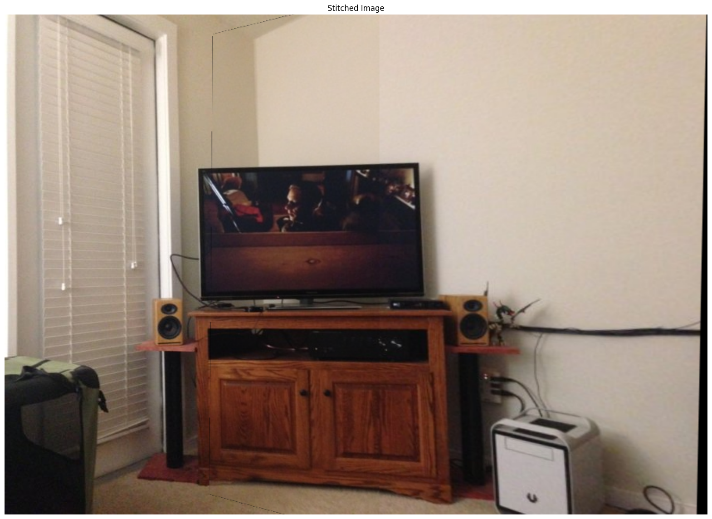
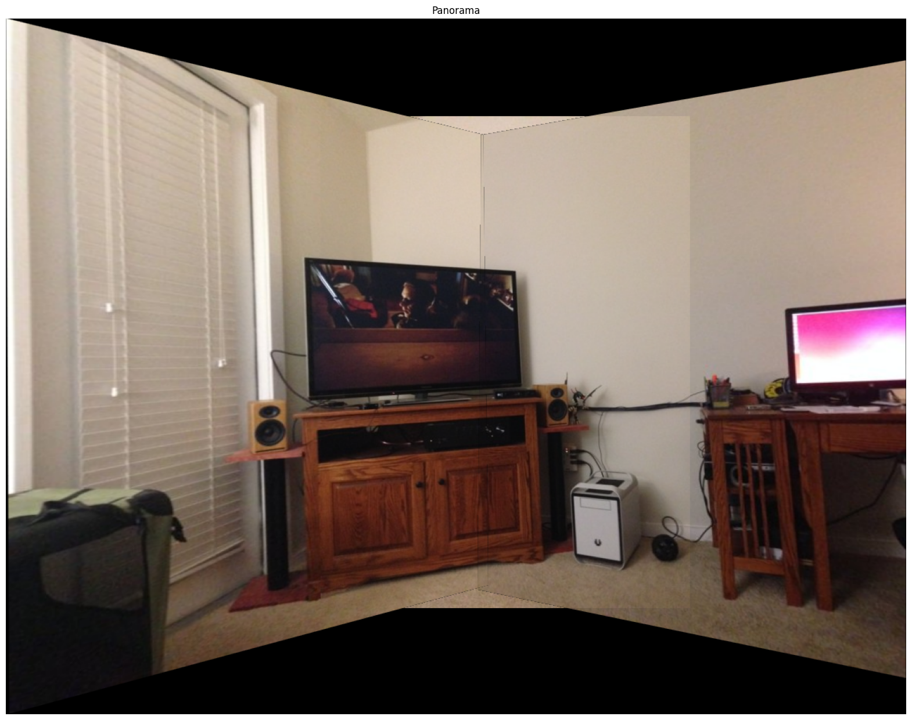

# Image Stitching & Panorama

Stitches overlapping photos into one image, or a wide panorama, using SIFT features, RANSAC homography estimation and perspective warping (no `cv2.Stitcher`).

| Two-image stitch | Three-image panorama |
|---|---|
|  |  |
